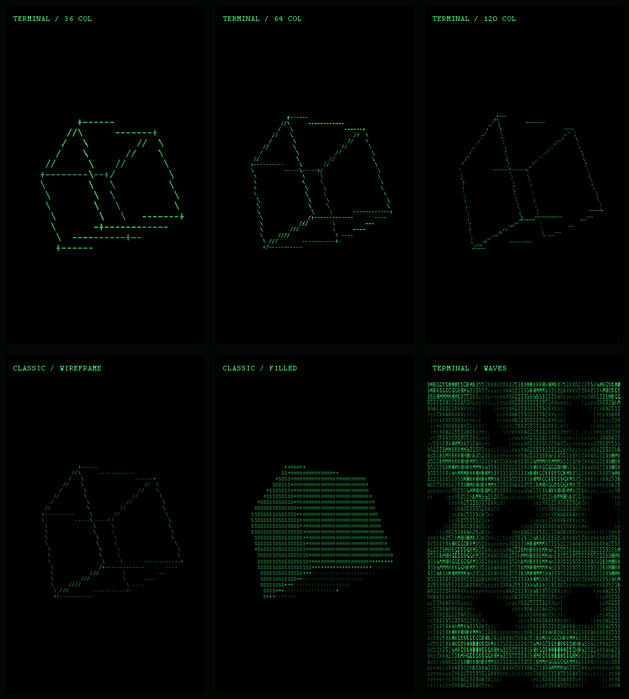

# ASCII Flow 1.2

Живые ASCII-обои с интерфейсом в стиле Matrix: вращающийся куб, волны, тор, сфера, галактика и цифровой дождь. Работает офлайн, без рекламы и регистрации.

**[Скачать APK](https://github.com/rheykd/ascii-flow/releases/latest)** · [Все релизы](https://github.com/rheykd/ascii-flow/releases)



## Совместимость и автопрофиль 1.2

Актуальный файл: `dist/ASCII-Flow-1.2.apk`. Устанавливается поверх 1.0/1.1 тем же ключом. Минимальная версия — Android 8.0 (API 26), целевая — Android 17 (API 37). APK содержит Java/Dex без нативных библиотек: отдельный файл для Samsung, Xiaomi, Pixel, ARM32, ARM64 или x86 не нужен. Устройство должно поддерживать системные живые обои.

Приложение автоматически читает производителя, модель, Android, минимальную ширину экрана и класс доступной памяти. При отсутствии ручной настройки плотности выбирает 36–100 столбцов по размеру экрана, ограничивая значение на устройствах с небольшим объёмом памяти. Такие устройства получают 15 FPS, остальные — 30 FPS; системное энергосбережение также ограничивает частоту до 15 FPS. Выбранные вручную плотность и стиль сохраняются. Кнопка автоматического подбора возвращает управление плотностью автопрофилю. Определение выполняется локально без идентификаторов устройства и без сети.

Сетка рассчитывается по фактическому размеру поверхности, включая поворот экрана; интерфейс поддерживает изменение размера окна. Установка проверяет поддержку обоев и ограничения администратора. Вызов API цвета обоев защищён проверкой Android 8.1+. Модель телефона искать и выбирать не нужно.

Проверены сборка, подпись, выравнивание APK и 900 кадров геометрии на разных размерах экранов. Физические устройства с Android 8–17 и OEM-прошивки не тестировались: это заявленный диапазон поддержки, а не подтверждение запуска на каждой модели.

Нативные ASCII-живые обои для Android. APK собран с Android SDK 37 (Android 17), минимальная версия Android 8.0. Не требует интернета, рекламы, регистрации или разрешений на файлы и камеру.

## Установка на телефон или планшет

1. Скачайте `ASCII-Flow-1.2.apk` из [Releases](https://github.com/rheykd/ascii-flow/releases/latest) и откройте его на Android. Версия подписана тем же ключом, что и 1.0/1.1, и устанавливается как обновление без удаления приложения.
2. При необходимости разрешите установку для приложения, из которого открываете APK.
3. Откройте **ASCII Flow**, выберите режим и настройки.
4. Нажмите **Установить живые обои** и подтвердите в системном окне. Доступные экраны для установки определяет прошивка телефона.

Режимы: куб с медленным вращением по центру, волны, тор, сфера, галактика, дождь. Настройки сохраняются автоматически и применяются к уже установленным обоям. При новой установке: зелёный Matrix, каркас куба, Terminal, 64 столбца, размер знака 90%, интервал строк 100%, скорость 1×, 30 FPS, яркость 80%. Существующие настройки цвета, скорости, яркости и режима сохраняются. В экономном режиме — 15 FPS; при системном энергосбережении обои также переходят на 15 FPS. Когда обои скрыты, постоянная отрисовка прекращается.

## Изменения 1.1

- Интерфейс зелёного терминала Matrix: моноширинные надписи, рамки, полосы сканирования в окне предпросмотра. Полноэкранный предпросмотр показывает сами обои без декоративных полос.
- Куб: заполненные поверхности или прозрачный каркас из 12 непрерывных цепочек ASCII-символов. Задние рёбра в каркасе также видны.
- Плотность: 24–180 столбцов с шагом 1; размер знака 40–150% от ширины ячейки; интервал строк 70–180%; независимый масштаб фигур 40–140%. Кнопки «− / +», точный ввод целого числа нажатием на значение, три пресета плотности. Размер сетки не зависит от шрифта, поэтому смена шрифта не искажает геометрию.
- Скорость 0–6× (точный ввод: 30 = 1×, 0 = пауза), яркость 5–100%, дополнительный цвет Matrix.
- Четыре шрифта с образцами: **Terminal** (пиксельный растровый стиль), **Classic / Cousine** (гладкий шрифт в духе классической консоли), системный Mono и жирный Mono. Это похожие свободные варианты, а не оригинальные шрифты Microsoft.

Растровый шрифт построен из [font8x8 Daniel Hepper](https://github.com/dhepper/font8x8), Public Domain; источник сохранён в `third_party/font8x8_basic.h`. [Cousine](https://github.com/google/fonts/tree/main/ofl/cousine) поставляется по SIL Open Font License 1.1. Оба шрифта и тексты лицензий включены в APK, сетевого подключения не требуется.

## Сборка в Windows

Нужны Python 3 и JDK 21. Укажите `JAVA_HOME`, если JDK находится не в `%USERPROFILE%/.jdks/corretto-21.0.13`.

```powershell
python tools/setup_sdk.py
python tools/build.py
```

SDK загружается с официального сервера Google; архивы сверяются по контрольным суммам из его репозитория. APK не содержит сторонних библиотек или нативного кода и подходит для ARM64. Сборка: aapt2 → javac → D8 → zipalign → apksigner. Целевая версия и compile SDK — 37.

Это APK для личной установки с локальным самоподписанным ключом `.toolchain/ascii-local.jks`. Сохраните ключ для будущих обновлений; он исключён из Git. Для публикации следует настроить собственный защищённый ключ. SHA-256 APK находится в `dist/SHA256.txt`.

## Проверки

`tests/SceneTest.java` проверяет анимацию всех шести режимов, корректность яркости, разные размеры и ориентации, длительное время работы и положение куба. `tests/FlexibleSettingsTest.java` проверяет соединение каркаса на 900 кадрах при разных плотностях и интервалах, полное покрытие экрана сеткой, переключение поверхностей, масштаб и оба встроенных шрифта. Тесты создают контактные листы режимов и настроек (рендер движка, не снимок интерфейса Android).

```powershell
& "$env:JAVA_HOME/bin/javac.exe" -encoding UTF-8 -d build/test-classes app/src/main/java/ru/ascii/wallpaper/AsciiScene.java app/src/main/java/ru/ascii/wallpaper/GridGeometry.java tests/SceneTest.java tests/FlexibleSettingsTest.java
& "$env:JAVA_HOME/bin/java.exe" -Djava.awt.headless=true -cp build/test-classes SceneTest
& "$env:JAVA_HOME/bin/java.exe" -Djava.awt.headless=true -cp build/test-classes FlexibleSettingsTest
```

Документация платформы: [Android 17 SDK](https://developer.android.com/about/versions/17/setup-sdk), [WallpaperService.Engine](https://developer.android.com/reference/android/service/wallpaper/WallpaperService.Engine).

Проверено при сборке 1.1: 150 тестовых кадров шести режимов и 900 кадров каркаса, центрирование куба на полном обороте, встроенные шрифты и лицензии, подписи APK v2/v3, совпадение сертификата с APK 1.0, целостность и выравнивание ZIP, minSdk 26 и targetSdk 37, наличие компонента живых обоев. Подключённого Android-устройства и настроенного эмулятора не было; запуск интерфейса и установка обоев на Galaxy S24 пока не проверены.
